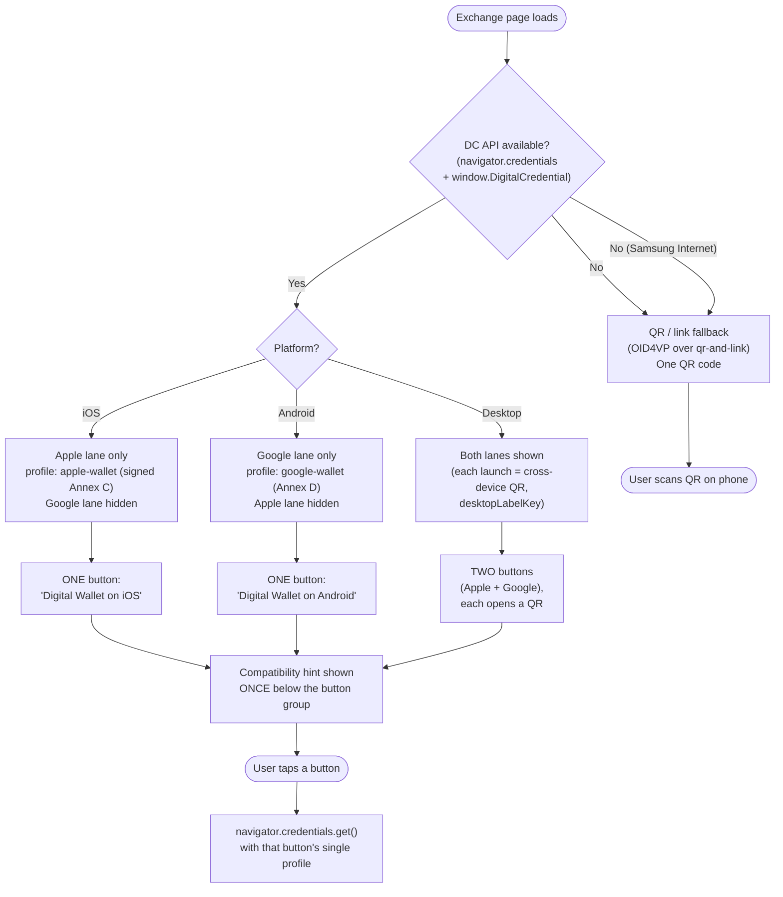

# DC API launch: profiles → buttons / QR

How a CA-DMV-shaped workflow (two configured `dcApiButtons`: an Apple lane and a
Google lane) resolves to what the user sees, by platform and DC API availability.
Reflects [platform-gated DC API buttons](../adr/2026-09-09-platform-gated-dc-api-buttons.md).

## How the gating is decided

- **DC API availability** is a feature check (`dcApiSystemAvailable`), not a
  version check. iOS ≈ 18 and older, and Samsung Internet, land in the QR/link
  fallback automatically.
- **Platform gating** is derived from the wallet registry: a button shows only
  when one of its handling wallets declares the current platform
  (`apple-wallet` → `ios`, `google-wallet` → `android`). Desktop is never gated.
- **Each lane sends one profile.** No signed+unsigned bundling and no iOS version
  tiers — so the "older iOS can't carry multiple protocols in one request"
  concern does not arise. See the ADR's "Decisions → 2" for why.

## Profile → wire protocol reference

| Lane | Button profile | Wire protocol | Wallet |
|---|---|---|---|
| Apple | `apple-wallet` | `org-iso-mdoc` (signed, `readerAuthAll`) | Apple Wallet |
| Google | `google-wallet` | `openid4vp-v1-signed` (`x509_hash`) | Google Wallet |
| Fallback | OID4VP default (e.g. `OID4VP-draft18`) | QR / link | any OID4VP wallet |

`cadmv-ios` and `18013-7-Annex-C` are the same unsigned `org-iso-mdoc` request
(no `readerAuthAll`); the deployed config uses the signed `apple-wallet` instead.
A single button may not carry two `org-iso-mdoc` profiles (validator ban).
